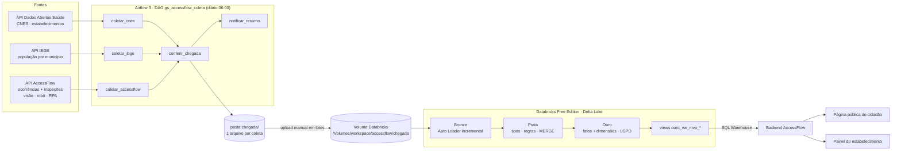
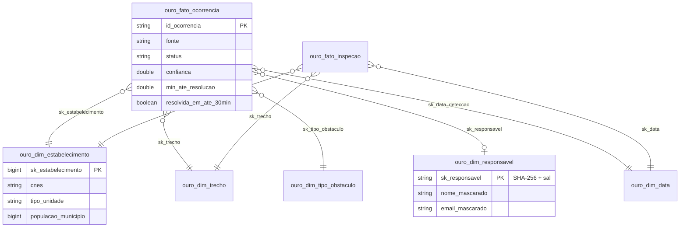

# Arquitetura de dados do AccessFlow

## Modelo dimensional (Ouro)

## Decisões

| Decisão | Por quê |
|---|---|
| NDJSON na chegada (CNES, AccessFlow) | 1 registro por linha: Auto Loader lê em paralelo e um registro ruim não invalida o arquivo |
| IBGE com schema explícito (`MAP`) | a chave do JSON é o ano; um ano novo não quebra a Bronze |
| Bronze tudo string + `_rescued_data` | Bronze não decide tipo; mudança na fonte não derruba a ingestão |
| MERGE com versão (`atualizado_em`) | a mesma ocorrência chega várias vezes; nunca regride para um status antigo |
| Quarentena em vez de descarte | dá para auditar e corrigir o que foi barrado |
| Ouro recriada a partir da Prata | determinística: reexecutar dá o mesmo resultado |
| Hash com sal via DataFrame | o sal não aparece no SQL nem no histórico de consultas |
| Views `ouro_vw_mvp_*` como contrato | o front não depende do layout interno das tabelas |
